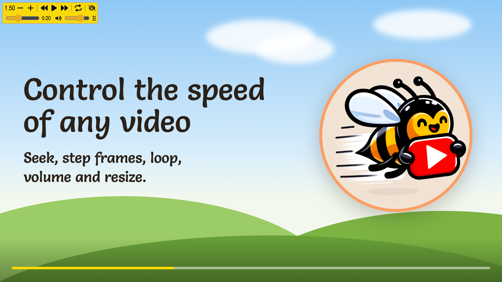
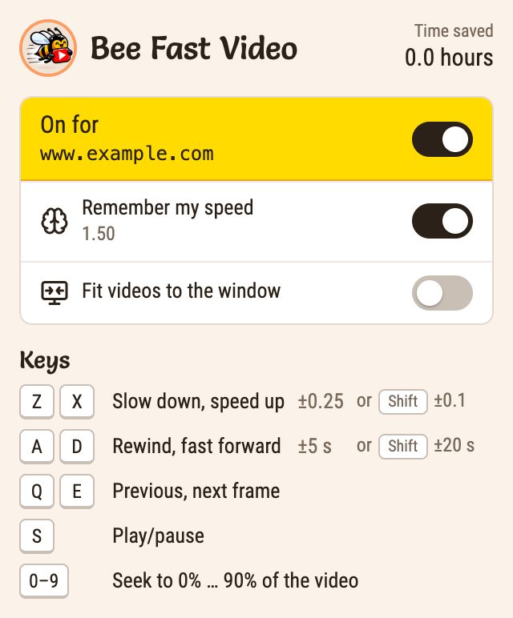

# Bee fast video

Install 🐝 on **[Chrome](https://chromewebstore.google.com/detail/bee-fast-video/lljkgbedmbiipekmphnhapdpfmkgbjbd)** or **[Firefox](https://addons.mozilla.org/en-US/firefox/addon/bee-fast-video/)**.

**Bee fast video** is a browser extension that offers greater control over videos on all websites.

## You can

- ✅ speed up (`X`) and slow down any video (`Z`)
- ✅ seek forward (`D`) and backward (`A`) through any video
- ✅ seek video to % on any video (like on YouTube) (`0 – 9`)
- ✅ play and pause (`S`) any video
- ✅ seek with a seek bar, see the time and duration, change volume, mute and go fullscreen, even when the site covers its video with elements that block the native controls
- ✅ drag the controls anywhere on the page (they snap back once the video leaves the viewport)
- ✅ resize any video in place by dragging its corner
- ✅ fit all videos on a site to the screen (per-site option in the popup), for sites whose videos don't fit the viewport
- ✅ toggle loop for any video
- ✅ toggle Picture-in-Picture (`P`) for any video (disabled, with an explanation, where the site or browser doesn't allow it)
- ✅ enable/disable controls on any website; useful for video conferencing

## Development notes

The extension was initially made based on a [Preact template](https://github.com/fell-lucas/chrome-extension-template-preact-vite), with most of the _extra_ stuff removed. The Preact was later replaced by [Solid](https://github.com/solidjs/solid) from version `v1.2.0`. Since `v2.0.0` the extension is built with [WXT](https://wxt.dev), which builds, generates the manifest and zips the extension for both Chrome and Firefox.

The extension consists of the content script (`entrypoints/content/`) and a popup (`entrypoints/popup/`). These two communicate only via settings in extension storage (`utils/settings.ts`).

### Content script

**ControllersContainer**

Most of the important bits are located within the content script. The execution starts from `entrypoints/content/index.tsx`, where the `ControllersContainer` is rendered into a shadow root (see [Styles](#styles)). `ControllersContainer` initially queries all available videos, after which it keeps track of newly added/removed videos via `observeForVideoElements` mutation observer. For every video we render a `Controller` component, which receives the reference to that video element. The shadow root's host element is intentionally an absolutely positioned, zero width and height element, in the top left corner of the page; Its purpose is to _house_ the `Controller` components, which are absolutely positioned over the top left corner of the video in respect to the host.

**Which videos get a controller**

A controller is shown only for videos that are in the viewport, visible (`checkVisibility`: not hidden by `display`, `visibility` or `opacity` on the video or its ancestors) and at least 50×50 px, and only after staying so for a second (`utils/video-visibility.ts`, `controller.tsx`). Pages often keep hidden, tiny or short-lived videos in the DOM (preloaded players, hover previews), and controllers for those only get in the way. The collapsed controller also lets the pointer pass through until the pointer rests on it for a moment, so it doesn't steal hover from the page.

**Controller**

The `Controller` both updates the video element based on the user actions, and keeps track of changes related to the video element. It will update its state based on these changes. It will try to adjust its position to be on top of its video immediately (if it's possible to detect) and periodically (to cover the cases where it's not possible to easily detect such changes). While shown, the `Controller` registers its video with `keyboardShortcuts` (`shortcuts.ts`), and unregisters it when the extension is considered _disabled_. Shortcuts are handled in the capture phase on `window`, so video players that stop key event propagation can't block them, and they control a single video: the one last hovered or interacted with, otherwise the largest visible one, preferring a playing one (`utils/target-video.ts`).

### Popup

The popup is there to present functionality and shortcuts to the user. It must be manually kept in sync if either the functionality or shortcuts change.

### Styles

Styles are plain CSS (with native nesting), imported from the entrypoint (`import "./style.css"`).

The content script UI is rendered inside a shadow root attached to a `<bee-fast-video-root>` host element, using WXT's `createShadowRootUi` with `cssInjectionMode: "ui"`, so the page's CSS can't affect the controls. WXT injects the imported CSS into the shadow root and resets inherited styles with `all: initial`. The content styles therefore use `:host` instead of a root class.

### Commands

- `npm run dev` / `npm run dev:firefox` - dev build with auto-reload. Load `.output/chrome-mv3-dev` (or `.output/firefox-mv3-dev`) as an unpacked/temporary extension once; WXT reloads it on changes.
- `npm run build` / `npm run build:firefox` - production build into `.output/chrome-mv3` / `.output/firefox-mv3`.
- `npm run zip` / `npm run zip:firefox` - store-ready zips in `.output/` (Firefox also gets the sources zip that AMO asks for).
- `npm run check` - type-check (`tsc`) and lint/format check ([Biome](https://biomejs.dev)).
- `npm run format` - apply Biome formatting and safe fixes.
- `npm test` - unit tests ([Vitest](https://vitest.dev)).

**Note**: Both browsers get a Manifest V3 build. The Firefox manifest additionally contains `browser_specific_settings` (add-on ID and data collection declaration); see `wxt.config.ts`.

  

