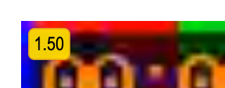
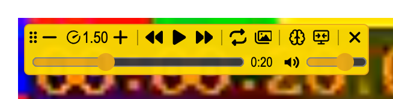

# Bee fast video

Install 🐝 on **[Chrome](https://chromewebstore.google.com/detail/bee-fast-video/lljkgbedmbiipekmphnhapdpfmkgbjbd)** or **[Firefox](https://addons.mozilla.org/en-US/firefox/addon/bee-fast-video/)**.


**Bee fast video** is a browser extension that gives you better control over videos on any website.

## What it does

Each visible video gets a small panel in its top left corner. At first it only shows the speed:



Click the speed to open the full panel:



- Speed: slow down (`Z`) and speed up (`X`) by 0.25, or by 0.1 with `Shift`. Scroll over the speed to change it. Right-click the speed to reset it to 1.00.
- Seek: back (`A`) and forward (`D`) by 5 seconds, or by 20 seconds with `Shift`. Keys `0`–`9` jump to 0%–90% of the video, like on YouTube. Scroll over the seek bar to move 5 seconds at a time.
- Play and pause (`S`).
- Step one frame back (`Q`) or forward (`E`). This pauses the video.
- Seek bar, time, volume and mute. These work even when the site covers its video so that the browser's own controls can't be reached. Click the time to switch between time played and time left. Scroll over the volume to change it.
- Loop.
- Picture-in-picture (`P`). The button is greyed out, with a tooltip saying why, when the site or browser doesn't allow it.
- Drag the panel anywhere by its grip. It goes back to its place once the video scrolls out of view.
- Resize a video by dragging the yellow square on its corner, shown while the panel is open. The size stays when you close the panel. Double-click the square to undo.
- Remember my speed on this site (brain button). Every video on the site then plays at the speed you last set with the extension. Speeds the site sets itself aren't remembered, like Twitch nudging the speed to catch up with a live stream.
- Fit videos on this site to 80% of the window (screen button). Useful on sites whose videos don't fit on screen.
- Hide the panel for one video. It comes back when the page reloads.
- Turn the extension off for a site, e.g. for video calls (in the popup).

The panel stays on top of the page and works in fullscreen when the site makes its player fullscreen, which is what most sites do. When the `<video>` itself is fullscreen (e.g. with the browser's own fullscreen button), the panel is shown and shortcuts work, but it can't be clicked: Chrome doesn't allow clicks on anything outside a fullscreen element, and a video can't hold other elements. That's also why the panel has no fullscreen button: use the site's.

The popup lists all keys and buttons:


Keyboard shortcuts work even when the site's player tries to swallow key presses, and they act on one video only: the one you last hovered or clicked, otherwise the biggest visible one, preferring one that's playing. The page still gets the key presses, so its own shortcuts keep working. Shortcuts are ignored while you type in a text field.

## How it works

The extension has two parts: a content script (`entrypoints/content/`), which runs on every page, and a popup (`entrypoints/popup/`). They don't talk to each other directly. They share settings through extension storage (`utils/settings.ts`).

### Content script

`index.tsx` renders `ControllersContainer` into a shadow root (see [Styles](#styles)). The container finds all videos on the page, watches for videos being added or removed, and renders a `Controller` for each one. It renders nothing until the settings are read and while the extension is off for the site, so turning it off undoes every change to the videos. The script runs in every frame, also in iframes without an address of their own (`about:blank`, `srcdoc`), and each frame shows panels for its own videos.

Videos inside shadow roots aren't found yet. Reddit's player is one: its videos sit in the open shadow root of a `<shreddit-player>` element.

The shadow root's host element is a popover, so it sits in the browser's top layer, above everything on the page. In fullscreen Chrome only lets you click inside the fullscreen element, so the host moves into it while it lasts. `host.ts` explains the details.

A `Controller` applies the site settings to its video (fit videos, remembered speed) and keeps a resized video's size. It shows a `Panel` (`panel.tsx`) only while the video is in view, visible and at least 50×50 px. Pages often keep hidden or tiny videos around, like preloaded players, and panels for those would only get in the way. `utils/video-visibility.ts` explains the rules.

`video-tracker.ts` follows where all videos are, in one pass per frame for all of them: on scroll (also inside scroll areas), on size changes, on fullscreen changes, and on a 1 s timer for moves nothing reports. Videos out of view cost nothing.

The `Panel` changes the video when you use its controls, and follows changes the page makes to the video, so it always shows the real state. Clicks on it never reach the page, so a player that pauses on click doesn't. The panel starts collapsed each time it shows.

While it shows, the panel registers its video for keyboard shortcuts (`shortcuts.ts`). Shortcuts listen on `window` in the capture phase, which runs before any of the page's own handlers, so a player can't block them. `utils/target-video.ts` picks the one video they act on.

All speed changes the user makes go through one function in `ControllersContainer`, which is also where "remember my speed" saves them. Speed, seek and volume changes are always relative to the current value and never snap to a grid like multiples of 5 seconds. So going back and forth while a video plays still moves forward. Scrolling changes values at most once every so often (`utils/wheel-stepper.ts`), so a trackpad and a mouse wheel change them at the same pace.

### Popup

The popup lists the controls and shortcuts, and has the per-site settings. Its list has to be updated by hand when controls or shortcuts change.

### Styles

Plain CSS with nesting. The popup imports its stylesheet normally.

The content script's panels live in a shadow root on a `<bee-fast-video-root>` element, created with WXT's `createShadowRootUi`, so the page's CSS can't affect them. The stylesheet is imported as a string (`style.css?inline`) and passed to `createShadowRootUi`, which also resets inherited styles. That's why the content styles use `:host` instead of a root class. WXT would otherwise fetch the CSS as a separate file at runtime, which pages can detect and which failed on some pages.

The "fit videos" option and resizing change the video's own inline styles with `!important`, and put the old values back when turned off (`utils/video-styles.ts`). Inline styles beat the page's stylesheets and aren't blocked by a page's Content-Security-Policy, unlike an added `<style>` element.

## Development

The project started from a [Preact template](https://github.com/fell-lucas/chrome-extension-template-preact-vite). It moved to [Solid](https://github.com/solidjs/solid) in `v1.2.0`, and to [WXT](https://wxt.dev) in `v2.0.0`. WXT builds the extension, writes the manifest and makes the zips for both Chrome and Firefox.

- `npm run dev` / `npm run dev:firefox`: development build that reloads on changes. Load `.output/chrome-mv3-dev` (or `.output/firefox-mv3-dev`) into the browser once as an unpacked (Firefox: temporary) extension.
- `npm run build` / `npm run build:firefox`: production build in `.output/chrome-mv3` / `.output/firefox-mv3`.
- `npm run zip` / `npm run zip:firefox`: zips for the stores in `.output/`. Firefox also gets the source zip that its store asks for.
- `npm run check`: type check (`tsc`), then lint and format check ([Biome](https://biomejs.dev)).
- `npm run format`: apply Biome's formatting and safe fixes.
- `npm test`: unit tests ([Vitest](https://vitest.dev)).
- `npm run test:e2e`: browser tests. They build the extension, install it in Chrome for Testing, and use it on the test pages in `e2e/pages` through [Puppeteer](https://pptr.dev).
- `npm run screenshots`: retakes the pictures of the panel and the popup in `docs/`.

### Browser tests

The browser tests need Chrome for Testing, a Chrome build made for automation that can load an unpacked extension (the normal Chrome can't, since version 137). Install it once, about 150 MB:

```sh
npm run e2e:install
```

It goes into `.cache/browsers`, which git ignores. Run it again to update to the latest stable version.

Each test file starts its own Chrome and a small local server for the test pages, and the files run in parallel. The test video (`e2e/pages/clip.webm`) is 60 seconds at 10 frames per second, so a frame step is exactly 0.1 s.

Both browsers get a Manifest V3 build. The Firefox manifest also has the add-on ID and the data collection declaration (`wxt.config.ts`).

<p align=center>
  
</p>
